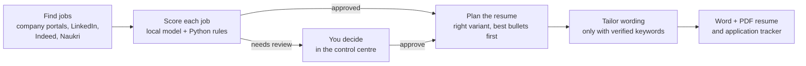

# PipelineHQ

**A local-first job-search pipeline that never invents a claim.**

PipelineHQ finds jobs, scores each one against your *verified* experience, and builds a tailored, two-page,
ATS-friendly resume for the good matches. A local AI model does the reading; plain Python enforces the rules, so
nothing on your resume is ever made up. It runs on your own computer, costs nothing, and never applies to jobs on its own.


*Dashboard with sample data: pipeline funnel, match scores, recent runs, sources and best-matching employers.*

---

## Why it exists

AI resume tools are good at writing, and that is the problem: they happily "improve" a resume with skills, numbers
and responsibilities the candidate never had. Recruiters notice, and so do interviewers.

PipelineHQ takes the opposite approach. Everything starts from a **Fact Bank**: a file of your real, verified bullets,
skills and proficiency levels. The model may only *choose, order and lightly reword* those facts, and every output is
checked by deterministic Python guards before it reaches a resume.

## What it does



1. **Find jobs** from company career portals (Workday, Greenhouse, Lever, Ashby, SmartRecruiters, SAP SuccessFactors),
   LinkedIn's public job pages (slow and polite, never your account), Indeed and Naukri, plus a watch list of companies.
   Duplicates across sources are merged; internships and off-domain titles are filtered out.
2. **Score** each job: the local model lists the job's requirements and quotes your Fact Bank as evidence; Python
   accepts a requirement as *met* only if the quote exists word for word, and applies the scoring gates.
3. **Choose a resume variant** (e.g. *design engineer* vs *configuration analyst*). Each job is scored for every
   variant you define, and only evidence that can appear on that variant's resume counts.
4. **Draft** the resume: the most relevant bullets move to the front of each role, the whole resume is kept to about
   two pages, and a bullet is reworded only when it can truthfully work in a job keyword you have proven.
5. **Build** the Word and PDF files from your own resume's layout, and track every application.


*A generated resume for the fictional sample profile.*

## How it stays honest

These are enforced in code (and covered by the tests), not left to the model:

- A requirement is **met** only with a **verbatim quote** from one Fact Bank line; anything else is at most *partial*.
- Skills you rated **novice / working knowledge** never count as fully met, whichever line is quoted.
- A requirement that names a tool (CATIA, ANSYS, …) needs evidence that names that tool.
- "Master's degree required" is not met by a Bachelor's; years-of-experience claims are never auto-proven.
- In-progress certificates are never evidence; removed claims are blocked as forbidden terms.
- Rewrites may not add numbers, tools or acronyms, drop qualifiers ("when consulted", "basic", "supported"),
  change tense, or drop technical terms; any violation falls back to your original wording.
- Visa, clearance, language or student-only postings are never auto-approved.

## The control centre

A small web app on your computer (and optionally your phone on home Wi-Fi):

| Page | What you do there |
|---|---|
| Dashboard | Run now, watch progress, see the funnel and charts |
| Approved | Open the job posting and the tailored resume, mark applied |
| Needs review | See exactly why each job was held; approve (resume is built) or archive |
| Leads | Paste the description of a job that came without one; it is scored like any other |
| Applications | Track status, dates and notes |
| Companies | Add any company by its careers link; the job platform is detected and tested automatically |
| Settings | Roles, locations, sources, daily schedule, phone access, notifications |
| Set up | Turn your resumes into a profile, confirming every fact |
| Health check | Everything PipelineHQ needs, with a fix for anything wrong |

## Quick start (macOS)

Requirements: Python 3.11+, [LM Studio](https://lmstudio.ai) (free) with a model such as **Qwen 3.5 9B**,
and optionally [LibreOffice](https://www.libreoffice.org) (free) for silent PDF conversion.

**Hardware:** a computer with **16 GB of memory** (e.g. an Apple-silicon Mac mini or MacBook) runs a 9B model at about
15-20 words per second; one job takes roughly 1-2 minutes to analyse. 8 GB machines can try a smaller model with weaker
results. Keep 20 GB of disk free for the model and files.

```bash
git clone https://github.com/<you>/PipelineHQ.git && cd PipelineHQ
python3 -m venv venv && source venv/bin/activate
pip install -r requirements.txt
cp .env.example .env                 # add any free cloud keys you have (all optional)
python -m unittest discover tests    # offline tests, a few seconds
python webapp/app.py                 # then open http://localhost:8765
```

It starts with the fictional **example** profile, so you can explore before adding your own data.
In LM Studio: load the model with **Context Length 16384**, start the local server, and turn the model's
"thinking" off (for Qwen 3.5, add `` as the first line of its prompt template).
Check it with `python modules/local_analyzer.py --probe`.

### Windows and Linux

Everything except two conveniences works the same: the pipeline, the control centre, resumes and the guided setup.
Not available outside macOS: the **morning run** and **background control centre** buttons (they use macOS's launchd).
Instead, schedule `python orchestrator.py` with Task Scheduler (Windows) or cron (Linux), and start the control centre
with `python webapp/app.py`. Use `venv\Scripts\activate` instead of `source venv/bin/activate` on Windows.
LibreOffice is recommended for PDFs on every system.

## Make it yours

**Guided setup (recommended, about 20 minutes).** On the Dashboard press **Set up my profile**:

1. Add every version of your resume (.docx, .pdf or .txt).
2. The local model **proposes** your roles, bullets, skills, education and certificates. Python checks every bullet
   against your resume text: bullets found word for word are pre-ticked; anything the model reworded starts
   **unticked** and is marked, so nothing invented slips in.
3. You confirm, edit or delete each item, and set honest skill levels (novice / working knowledge never count as a
   full match).
4. Name one or two resume variants, write a short summary in your own words, pick a starter pack for your field
   (mechanical, software or general), and optionally upload a resume whose layout you like.
5. The profile is validated, saved in `profiles/<yourname>/` and switched on.

**By hand.** Everything personal lives in one folder, `profiles/<yourname>/`, which is never committed:

| File | What it holds |
|---|---|
| `fact_bank.json` | Your roles, verified bullets, skills (with proficiency), education, certificates |
| `resume_profile.json` | Resume variants: which roles, bullets and skills each uses, headline, summary |
| `domain.toml` | Profession rules: synonyms, tool names, title words to exclude, blockers, watch list |
| `search.toml` | Roles, locations, sources, schedule (edited from Settings) |
| `resume_template.docx` | Your resume's layout: `python modules/resume_builder.py --make-template your_resume.docx` |

Copy `profiles/example/` to `profiles/<yourname>/`, replace the content, and select it in `config.local.toml`:

```toml
[pipeline]
profile = "yourname"
```

**Health check.** The Dashboard shows a health line; the **Health check** page (or `python modules/doctor.py --model`)
verifies Python packages, your profile, LM Studio (server, loaded model, context length, thinking switched off), the
PDF converter, cloud keys, disk space and the morning run, with a plain fix for anything wrong.

## Daily use

- **Run everything:** press **Run now** on the dashboard, or `python orchestrator.py`.
- **Every morning:** switch on the daily run in Settings (uses macOS's built-in scheduler; the Mac runs it on wake
  if it was asleep).
- **From your phone:** in Settings, run the control centre in the background, set a passcode, then open the shown
  address in Safari and *Add to Home Screen*. Optional push notifications via the free *ntfy* app.

## Costs and privacy

Free to run. The heavy work uses a local model; the optional cloud polish uses free tiers (Gemini, Groq, Cerebras,
NVIDIA, OpenRouter, Mistral) and only ever sees individual bullets plus the job title. Your Fact Bank, resumes, job
data and keys stay on your computer. `scripts/privacy_check.py` checks every file before you publish anything.

## Limits and responsibility

- Scraping job boards may conflict with their terms of service; you run it at your own discretion. LinkedIn is read
  only through public job pages, at a deliberately slow pace, with a small request budget per run.
- Some career platforms (e.g. Avature, Oracle, Taleo) are not supported yet; such companies are searched on the job
  boards instead. Naukri often hides descriptions behind a captcha; those jobs appear as leads to paste.
- PipelineHQ never submits applications. You review and apply yourself.

## Project layout

```
orchestrator.py          one command for the whole chain
modules/scraper.py       Phase 1: portals, job boards, LinkedIn fetcher, dedupe, watch list
modules/local_analyzer.py  Phase 2-3: model analysis, Python guards, scoring, variants
modules/cloud_generator.py Phase 4: resume plan and guarded tailoring
modules/resume_builder.py  Phase 5: Word/PDF resumes and the application ledger
modules/companies.py     add companies, detect their job platform
modules/onboarding.py    guided setup: resumes -> verified, confirmed profile
modules/doctor.py        health check with plain-English fixes
modules/scheduler.py     daily run and background control centre (macOS launchd)
webapp/                  the control centre
profiles/example/        fictional sample profile
profiles/_packs/         starter rules for mechanical, software and general profiles
tests/                   offline tests
```

## Roadmap

- Connector for Avature career sites
- Recruiter / hiring-manager outreach drafts grounded in the Fact Bank
- Interview preparation (STAR answers) per approved job, from the evidence map

## Author

Built by **Mohammed Abul Faise**, mechanical design engineer: [LinkedIn](https://www.linkedin.com/in/mohammed-abul-faise).

Released under the [MIT licence](LICENSE).
